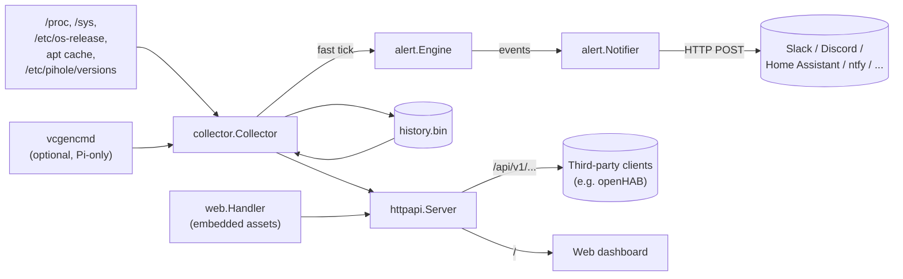

# Architecture

<!-- project:begin architecture -->
This document describes how PiMonitor is put together and, where the reasoning is
recoverable from the code, comments, or existing docs, *why* it looks the way it does.
It complements [`README.md`](../README.md) (features, build, install), [`CONTRIBUTING.md`](CONTRIBUTING.md)
(workflow), [`UNIT_TESTS.md`](UNIT_TESTS.md) (test conventions), [`API.md`](API.md)
(REST API contract), and [`SECURITY.md`](../SECURITY.md) (threat model) rather than
repeating them.

## Areas

What each part does — values, limits, formats, error behavior, guarantees — is stated once, in the area documents
under [`areas/`](areas/README.md); this document links them instead of repeating them:

- [Metrics](areas/metrics.md) — what is collected, from which source, in which unit and at which cadence, and what
  a missing or failing source yields.
- [History](areas/history.md) — the retained time series, their capacity and eviction, and `history.bin`: when it
  is written, its format, and the restore on startup.
- [Alerts](areas/alerts.md) — thresholds, debounce, level transitions, events and `GET /api/v1/alerts`.
- [Notifications](areas/notifications.md) — webhook delivery: severity filter, payload and templates, queues,
  retries, rate limit and logging.
- [HTTP API](areas/http-api.md) — routes and when they are registered, authentication, compression, caching, the
  concurrency limit, security headers, `/healthz`, Prometheus, server stats, TLS and timeouts.
- [Dashboard](areas/dashboard.md) — asset serving and caching, polling, the history merge, API key handling,
  rendering, coloring, alert badges, layout and theme.
- [Configuration](areas/configuration.md) — sources and their precedence, every option with its default and valid
  range, validation and startup failure.
- [Deployment](areas/deployment.md) — the release archive, `install.sh`, the systemd units and their sandboxing,
  the apt refresh timer, the data directory and the process lifecycle.

---

## High-level shape



PiMonitor ships as a **single statically-linked Go binary** (`cmd/pimonitor`) with no
runtime dependencies beyond the target Linux kernel — no database, no separate frontend
build, no container runtime. It runs as one systemd service (`pimonitor.service`) that
does everything: metric collection, alert evaluation, webhook delivery, and serving both
the REST API and the dashboard's static assets from the same `net/http` server.

A second, separate systemd unit (`pimonitor-apt-update.timer`) runs as root and refreshes
the apt package cache on a schedule; `pimonitor.service` itself never needs elevated
privileges. This privilege split is the central security design decision of the project —
see [Privilege separation](#privilege-separation-and-deployment) below and
[`SECURITY.md`](../SECURITY.md).

## Process wiring (`cmd/pimonitor/main.go`)

Behavior: [Deployment](areas/deployment.md#process-lifecycle), [Configuration](areas/configuration.md).

`run()` is the composition root: it resolves configuration, then constructs and wires
together the following collaborators before starting anything:

1. `config.Load` — resolves `Config` from built-in defaults, an optional YAML file, the
   environment and CLI flags (see [Configuration](#configuration-internalconfig)).
2. `alert.NewNotifier` — builds the webhook notifier from `cfg.Alerts`; returns `nil` with
   no error when no webhooks are configured, so the rest of the code can treat a `nil`
   `*Notifier` as "notifications disabled" without a separate feature flag.
3. `collector.New` — builds the `Collector`, wiring in the notifier and the alert engine
   configuration.
4. `web.Handler` — returns an `http.Handler` serving the embedded dashboard assets.
5. `httpapi.New` — builds the `Server`, given the collector (as a narrow
   `MetricsProvider` interface) and the static handler.

The collector and the HTTP server then run as two goroutines under a shared
`signal.NotifyContext(SIGINT, SIGTERM)`. On shutdown, `server.Shutdown` gets a grace period, and `main` waits for
the collector's own shutdown path (which waits for a running history write and then writes the final state itself, see
[History persistence](#history-persistence-internalcollectorpersistgo)) to finish — bounded by the same shutdown
context, so a stuck write cannot hang the process indefinitely. The deadline and exit statuses are in
[Deployment](areas/deployment.md#process-lifecycle).

## Metric collection (`internal/collector`)

Behavior: [Metrics](areas/metrics.md); retained series and eviction: [History](areas/history.md).

`Collector` (`collector.go`) owns one sub-collector struct per metric family — `cpu`,
`cpuFreq`, `loadAvg`, `memory`, `disk`, `diskIO`, `network`, `wireless`, `hwmon`, `temp`,
`throttled`, `sysInfo`, `updates`, `pihole`, `uptime`, `processes` — each in its own file (`cpu.go`,
`memory.go`, ...) with a `Collect()` method that reads `/proc`/`/sys` (or shells out to
`vcgencmd`/`apt` where no `/proc`/`/sys` source exists) and returns a typed value plus an
error. Every one of these parsers takes its source path or input as a field or parameter, so it is unit-testable
against fixture strings rather than real `/proc`/`/sys` access — see [`UNIT_TESTS.md`](UNIT_TESTS.md). The same
isolation is what keeps PiMonitor runnable off the Pi: a source that does not exist on the development machine (no
thermal zone, no `vcgencmd`, no cpufreq driver) is a tested path that yields an empty or zero value, never a crash
and never a fabricated reading. What each missing or failing source yields, and which failures are logged, is in
[Metrics](areas/metrics.md#limits-and-errors).

**Two independent tickers** drive collection, both served by the single `Run` goroutine, so a fast and a slow tick
never run in parallel:

- **Fast tick** (`fastTick`, every `poll_interval_seconds`): the cheap, fast-moving metrics — CPU, load,
  temperatures, throttling, memory, disks, disk I/O, network. The sources are read one after another and isolated
  from each other: a failure in one metric (e.g. no thermal zone on non-Pi hardware) leaves that field empty for
  this snapshot rather than blocking the others.
- **Slow tick** (`slowTick`, every `updates_check_minutes`): available apt updates, Pi-hole's update state and,
  when `processes_enabled` is set, the top-N process rankings (`process.go`). These are deliberately much less
  frequent than the fast tick: the underlying apt cache is itself only refreshed by the separate root-privileged
  timer, and walking every `/proc/<pid>` entry is too costly to repeat at the fast tick's cadence. The three are
  independent of each other, matching the fast tick's per-source error isolation.

  Pi-hole's state (`pihole.go`) needs its own source because Pi-hole is installed by its own installer, not
  through apt, so its updates never show up in `apt list --upgradable`. Instead of querying GitHub or the Pi-hole
  API (network access, rate limits, a Pi-hole password in PiMonitor's config), the collector reads
  `/etc/pihole/versions`, which Pi-hole's own update checker rewrites daily — the same "privileged/other process
  refreshes, PiMonitor only reads" split as the apt cache. The result is a separate `Snapshot.Pihole`, never folded
  into `Updates.Count`, so integrations reading the apt count keep its meaning. On `master` only version numbers
  are compared, because the installed hash is the release tag's and legitimately differs from what the update
  checker records as the remote hash.

**Snapshot + history, guarded by one `sync.RWMutex`.** `Collector.latest` holds the most
recent value of every metric (`Snapshot()` returns a copy under `RLock`); each scalar
metric additionally feeds a `RingBuffer[HistoryPoint]` (`History()` returns a copy of
every buffer's contents). Per-device metrics (disk, disk I/O, network) use a
`map[string]*RingBuffer[HistoryPoint]` keyed by mountpoint/device/interface name, created
lazily the first time a given device is seen. `RingBuffer[T]` (`ringbuffer.go`) is a fixed-
capacity circular buffer with its own internal lock — safe to read concurrently with the
collector's own tick, independent of the collector's outer `sync.RWMutex`.

Per-device series are also removed again (`evictStaleSeries`, called from `fastTick`): without that, a churning
`veth*` interface from container start/stop or a USB drive that gets unplugged would keep its full ring buffer (and
keep showing up in `GET /api/v1/metrics/history`) forever. Eviction deliberately differs from the alert engine's
`pruneDisks` (see below), which drops state on a single absent sample: `DiskCollector.Collect` already skips a
mountpoint that transiently fails to stat, so evicting history on the first miss would wipe a device's history over
a passing blip rather than an actual disappearance — eviction is tied to the history window instead, so only a
sustained absence is treated as gone. The exact rule is in [History](areas/history.md#series-of-vanished-devices).

The ring buffer capacity (`config.Config.HistoryCapacity()`) is derived from the history window and the poll
interval, not configured directly, and the configuration caps it: `NewRingBuffer` allocates its capacity eagerly,
so an extreme window/interval ratio from a config typo would otherwise allocate on the order of gigabytes at startup
and OOM a Pi. `Config.Validate()` rejects such a ratio at startup rather than letting it crash later; the limit is in
[Configuration](areas/configuration.md#top-level).

## History persistence (`internal/collector/persist.go`)

Behavior: [History](areas/history.md) — when the file is written, its format and limits, and the restore on startup.

When persistence is enabled, the collector periodically snapshots all history buffers to a single file
(`<data_dir>/history.bin`) so sparklines survive service restarts and reboots, without a database. The format is a
small hand-rolled binary encoding, and decoding enforces hard limits before it
allocates anything, so a corrupt or malicious file cannot trigger an oversized allocation.

- **Written on the slow tick and on clean shutdown.** `Run`'s `ctx.Done()` branch calls `flushHistory`, which
  waits for a slow-tick write still running and then encodes and writes the latest state on the collector's own
  goroutine, so the file a clean stop leaves behind holds the final state unless the shutdown deadline abandons
  the write (see [decision 0004](decisions/0004-final-history-write-waits.md) and
  [History](areas/history.md#persistence-when-it-is-written)).
- **Written asynchronously**: `persistHistory` snapshots `Collector.History()` on the
  calling goroutine (a consistent point-in-time view), then hands the write off
  to a background goroutine tracked by `Collector.persistWG`. On a Pi the atomic write's
  `fsync` can stall the SD card for hundreds of milliseconds, and `Run`'s `time.Ticker`
  drops rather than queues any fast tick that falls due meanwhile — running the write
  inline on the tick goroutine would silently punch a hole in the very history being
  persisted. A buffered try-lock (`Collector.persisting`) skips — rather than queues — a
  write while a previous one is still in flight, since the next write carries newer data
  anyway. The wait on shutdown is bounded by `cmd/pimonitor/main.go`'s shutdown context (`awaitCollector` selects on
  `collDone` vs. `shutdownCtx.Done()` and `run` logs a warning at the deadline), so a stuck fsync cannot hang the
  process.
- **Written atomically**: `writeFileAtomic` writes to a temp file in the same directory, flushes it, then renames
  it over the target path — a crash mid-write can never leave a partially written history file behind. The
  directory is synced afterwards so the rename itself survives a power cut; that sync is best-effort, since the file
  is already in place and some platforms cannot sync a directory at all.
- **Read on startup** (`loadHistory`): a missing, unreadable or corrupt file never stops the service from
  starting — history is a convenience, so the collector starts with empty history instead.
- **Versioned, not migrated**: unknown series kinds are skipped on decode (forward
  tolerance for old binaries reading a file written by a newer one that only adds series
  kinds), but any change to the record layout itself must bump `historyVersion` rather
  than attempt an in-place migration — there is intentionally no migration path, since the
  data is disposable derived state (it can always be dropped and rebuilt from scratch).

## Alert engine (`internal/alert/alert.go`)

Behavior: [Alerts](areas/alerts.md).

`alert.Engine` turns each fast-tick snapshot into per-metric `ok`/`warn`/`crit` states
plus a rolling list of `fired`/`cleared` transition events, served via
`GET /api/v1/alerts`. It is fed synchronously from inside `Collector.fastTick`, while it
holds its own separate mutex — this is safe because the engine never calls back into the
collector, so evaluating it while the collector's own lock is held cannot deadlock.

**Debounce is the core design element.** A raw threshold crossing does not immediately
change the reported state; it must persist for the debounce window before being promoted,
so a single-sample spike shorter than the window never fires an event, and — applied
symmetrically — a momentary dip during a sustained alert never clears it either. The warn
and crit boundaries are tracked as two *independent* timers per metric
(`metricState.warnSince` / `critSince`) rather than one raw ok/warn/crit band, so a value
oscillating in and out of the crit band while staying continuously above the warn cutoff
still correctly fires a warn alert instead of having its debounce window reset every time
it crosses back out of crit.

**Invalid samples never corrupt state.** Each metric in a `Sample` carries a `*Valid`
flag; when collection fails for a metric on a given tick (e.g. a disk read error), that
metric is skipped entirely for that evaluation rather than being evaluated against a
bogus zero value — this prevents a transient collection error from spuriously clearing a
real alert.

**Disks are pruned, not garbage-collected implicitly.** Because disks are a dynamic,
per-mountpoint set, `pruneDisks` explicitly removes alert state for any mountpoint absent
from the latest (valid) sample — e.g. an unmounted USB drive — and emits a final
synthetic `cleared` event if that mountpoint was still alerting, so a vanished filesystem
can't leave a permanently "stuck" alert in the report.

The value-to-level cutoffs are the same inclusive `>=` comparison the dashboard's frontend (`app.js`'s
`levelClass`) uses for card coloring, so the server-reported alert state always agrees with what the dashboard
visually shows.

## Alert delivery (`internal/alert/notify.go`)

Behavior: [Notifications](areas/notifications.md).

`alert.Notifier` POSTs alert transition events to zero or more configured HTTP webhooks
(Slack, Discord, Home Assistant, ntfy, or any endpoint accepting a JSON/templated body).
Delivery is fully decoupled from collection: `Notify` only enqueues events and returns
immediately; background worker goroutines (`Start`/`dispatch`) drain the queues and
perform the actual (retrying, potentially slow) HTTP calls. This guarantees a hung or
failing webhook endpoint can never stall the collector's fast tick — if a queue fills up
(a persistent backlog of slow deliveries), further events are dropped with a logged
warning rather than blocking.

**Each webhook gets its own bounded queue and its own worker** (`webhookWorker`). Delivery to one destination is
therefore never held up by another: a webhook pointing at a dead host can only delay — and only ever drop — its own
events. `Notify` applies the severity filter inline (it is pure and cheap) and fans the
event out onto the queue of every webhook it reaches.

The per-`(metric, resource)` rate limiter coalesces repeated firings. Each successful delivery drops the entries
whose window has already run out, so resources that come and go (removable media, container mounts) don't
accumulate keys for the life of the process.

Custom bodies are rendered with `text/template`, which does no escaping of its own. Rather than escaping
behind the template author's back, the notifier registers a `json` template function (`templateFuncs`) that
marshals a value including its surrounding quotes, so a resource string containing a quote or backslash (e.g. an
unusual mountpoint) can't produce a malformed request body; how a template must use it is in
[Notifications](areas/notifications.md#custom-templates).

**Only retryable failures consume the retry budget.** Transport errors (DNS, refused connections, timeouts — and a
malformed or unreachable URL, which the client reports the same way) and 5xx responses are treated as transient,
as are `408 Request Timeout` and `429 Too Many Requests`, which explicitly invite a retry. Every other 4xx is a
permanent rejection of that exact request — a revoked webhook, a payload the endpoint refuses — so `deliver` gives
up after the first attempt instead of re-POSTing an identical body that cannot succeed. `cleared`
events deliberately bypass the rate limiter — a recovery signal must always reach a
state-based consumer (e.g. a Home Assistant `binary_sensor`) so it can never get stuck
reporting an alert that has actually cleared; only repeated *firings* are coalesced.

## HTTP layer (`internal/httpapi`)

Behavior: [HTTP API](areas/http-api.md); JSON shapes: [`API.md`](API.md).

`httpapi.Server` wraps a single `http.ServeMux` behind two distinct middleware layers
(`server.go`, `middleware.go`): a pair of wrappers around the whole mux, and a longer
chain (`apiRoute`) applied to each route that asks for it — every `/api/v1/...` handler,
plus `GET /metrics` when it is enabled:

```
global:            withLogging(withSecurityHeaders(mux))
per apiRoute:      withNoStore(withMaxInFlight(withGzip(withAPIKey(handler))))
```

`/healthz` and the static dashboard assets only pass through the global layer — that is
exactly why they are the routes not gated by `withAPIKey`, not rate-limited by
`withMaxInFlight`, and not marked uncacheable by `withNoStore`.

The route set itself lives in one place: `routeTable` in `routes.go`, which records each
route's method, path, whether `apiRoute` wraps it, and an optional predicate deciding
whether the running configuration registers it at all. `New` registers from that table,
`routeBucket` classifies request paths against it, and `newServerStats` pre-populates its
counters from it. Those three used to be separate lists, and a route added to only the
first got no bucket of its own: its requests fell into whichever shared fallback matched
the path, so `GET /api/v1/serverstats` misattributed them. That is how `GET /metrics` scrapes came to
be counted as dashboard-asset traffic. The per-metric sub-resources are part of that
same table: they are generated from `metricsSubResources` (also `routes.go`), a list of
snapshot field name/accessor pairs that `routeTable` is built by appending, so each one
gets its route, its middleware chain and its own counter bucket from a single entry —
and, because the accessor returns the snapshot field itself, its response can never
become a second representation of a metric that drifts from `GET /api/v1/metrics`.
Bucketing deliberately ignores the predicate, so the response shape does not vary with configuration and a request
to a disabled route is still visible under its own key — the bucket comes from the request path, not from which
handler (or the mux's `404` fallback) served the request.

What each middleware guarantees is in [HTTP API](areas/http-api.md); the reasons for their design:

- **`withSecurityHeaders`**: the Content-Security-Policy can be this strict specifically because the dashboard is
  fully self-contained — all scripts/styles are same-origin embedded files and the favicon is a `data:` URI, hence
  the narrow `img-src` allowance for `data:`. The directives that do not fall back to `default-src` (`base-uri`,
  `form-action`) are set explicitly, and plugin content is ruled out outright.
- **`withLogging`**: a `statusRecorder` wrapper captures the status code a downstream handler wrote (not otherwise
  exposed by `http.ResponseWriter`), so every request is recorded in `serverStats` (`serverstats.go`), bucketed by
  `routeBucket` to keep the counter set a fixed size regardless of what path a client requests. The debug access
  line is a separate switch (`access_log_enabled`), so silencing it leaves the counters unaffected (issue #43).
- **`withAPIKey`**: the provided and the configured key are both SHA-256 hashed before
  `crypto/subtle.ConstantTimeCompare`, so the comparison runs in constant time over a fixed-length digest — this
  avoids leaking either the key bytes or the configured key's *length* through response timing. Without a key every
  request is allowed — the common case (dashboard on a trusted LAN) stays unauthenticated and simple. `/healthz` is
  never gated, so external health checks work regardless of auth configuration.
- **`withGzip`**: the underlying `gzip.Writer`s come from a `sync.Pool` rather than being allocated per request,
  since the `/api/v1/...` endpoints are polled every few seconds. It appends its `Vary` value (`Header.Add`, not
  `Set`) so it doesn't clobber the values `withNoStore` already set. A client that doesn't negotiate gzip gets an
  unmodified identity response, so `withGzip` stays backwards compatible for naive `/api/v1` consumers — see
  [`API.md`](API.md#compression) for the wire-level contract.
- **`withMaxInFlight`**: a shared semaphore that answers excess requests at once instead of queueing them. This
  bounds worst-case concurrent CPU/memory on a Pi Zero: an unauthenticated flood of requests to the history endpoint
  (the most expensive one — see below) can no longer multiply without limit. `/healthz` is deliberately excluded so
  a monitoring system can still tell the process is alive while the API is shedding load.
- **`withNoStore`**: metric/alert/config responses are point-in-time and, with an API key set,
  credential-protected — a shared cache such as a reverse proxy fronting the Pi must not retain them or hand an
  authorised response to an unauthorised client. It is outermost in the chain so its headers land before anything
  downstream writes, including on a `401` from `withAPIKey`.

**Routes** come from `routeTable`, except the catch-all `GET /`, which serves the embedded dashboard via the
`staticHandler` passed into `New` (`nil` in tests, to exercise the API layer without the frontend). The full route
list, including the per-metric sub-resources and the routes registered only when their option is on, is in
[HTTP API](areas/http-api.md#routes); response schemas are in [`API.md`](API.md). A breaking change to an `/api/v1`
shape gets `/api/v2/...` instead ([REST API stability](CONTRIBUTING.md#rest-api-stability)).

`/healthz` is a liveness check, not just a process-alive probe: `handleHealthz` (`handlers.go`) reports unhealthy
once the latest snapshot is older than `Config.HealthzMaxStaleness` — e.g. the collector goroutine has stalled while
the HTTP server is still serving requests. `main.go` always sets that bound from
`config.Config.HealthzMaxStaleness(collector.WorstCaseTickOverhead)`. The derived default cannot be the poll interval
alone: `Collector.fastTick` (`collector.go`) publishes `latest.Timestamp` only when a tick *completes*, and it runs
collectors that degrade via timeout rather than fail fast (a hung `vcgencmd` call, a stalled `statfs`), so a single
legitimately slow tick can already take `collector.WorstCaseTickOverhead`, and the timestamp visible right before
the *next* tick publishes can lag by up to twice that. Ignoring this would make `/healthz` flap unhealthy on a Pi
whose only problem is slow firmware calls. `internal/config` cannot compute this for itself: it cannot import
`collector` (which already imports `config` for `Thresholds`), so `main.go` is where the two are combined. The
resulting value is in [Configuration](areas/configuration.md#top-level).

**`MetricsProvider` is a narrow interface** (`Snapshot() / History() / HistoryGeneration() / Alerts() /
Processes()`) implemented by `*collector.Collector`, so `httpapi` can be unit-tested
against a fake implementation (see `handlers_test.go`) entirely independent of real
`/proc`/`/sys` access — the same testability principle the collector package applies to
its own parsers.

**`handleHistory` caches its encoded response.** `Collector.History()` deep-copies every
retained ring buffer under lock — the most expensive request the service serves — but the
underlying data only changes once per `fastTick`. `Collector.HistoryGeneration()` returns
a counter bumped each `fastTick`; `Server` keeps the last generation it encoded alongside
the encoded bytes and reuses them whenever the generation is unchanged, so concurrent
pollers between ticks share one deep-copy-and-encode instead of each paying for their own.

**`handleHistory` serves deltas via `?since=`.** Caching removes the repeated work between
ticks, but not the far larger cost of resending a window the client already holds: at the
default settings that is several thousand points serialised and gzipped once a minute per
poller. `?since=` reduces the response to the points newer than the client's newest one
(`collector.History.Since`), which turns the dashboard's steady-state poll into a few hundred bytes. Omitting the
parameter returns the full window unchanged, so the parameter is additive and `/api/v1` stays compatible; an
unparseable value is rejected rather than silently answered with the full window, which would hide a broken client
from itself. Because history points are stored oldest first, filtering is a prefix cut
found by binary search (`dropPrefix`, shared with `importHistory`'s window trim), and the
cached deep copy is re-sliced rather than copied again — so the full-window encoding is
only built when something actually asks for the full window.

**`GET /api/v1/config`** exists specifically so the frontend doesn't have to duplicate
values (poll interval, alert thresholds, feature toggles) that are already defined
server-side; it also echoes back the build-time `version` injected via
`-ldflags -X main.version=...`. `ClientConfig.Thresholds` is `config.Thresholds` itself
(carrying both `yaml:` and `json:` tags), not a second, hand-copied struct — a threshold
added to the config file automatically reaches this endpoint with no field-by-field
mapping to keep in sync. Only `internal/web/assets/app.js`'s client-side fallback
defaults (rendered before this endpoint resolves) still duplicate the key set by
necessity; a test in `internal/web` guards that copy against drift via reflection over
`config.Thresholds`'s json tags.

## Web dashboard (`internal/web`)

Behavior: [Dashboard](areas/dashboard.md).

`web.Handler()` embeds `internal/web/assets/*` (`index.html`, `app.js`, `chart.js`,
`gauge.js`, `theme-init.js`, `style.css`) into the binary via `//go:embed` and serves them
with `http.FileServerFS`. There is **no frontend build step** — no bundler, no npm
toolchain, no framework — the assets are plain HTML/CSS/JS shipped as-is, consistent with
the project's "prefer the standard library, minimize dependency surface" philosophy (see
[`CONTRIBUTING.md`](CONTRIBUTING.md)).

Because embedded files carry a zero `ModTime`, `http.FileServerFS` alone would emit no
`Last-Modified`/`ETag` and no `Cache-Control`, forcing a full refetch of every asset on
every page load. `Handler` therefore wraps the file server to mark assets for revalidation and give each one a
**validator derived from its own contents**, computed once at construction (the asset set is fixed at compile time
and tiny, so this costs microseconds and no per-request work). Browsers revalidate with a cheap conditional request
and refetch as soon as a file's bytes change; the headers are specified in
[Dashboard](areas/dashboard.md#asset-serving).

The content hash replaces an earlier `version`-derived ETag, which was wrong in two ways: it gave
every asset the *same* validator despite each URL being a distinct resource, and it never
changed across builds that share a version string — which is every unversioned `dev`
build, so `make run` served permanently stale JavaScript after an edit (issue #102).

The validator is attached only to a response that actually *is* the hashed asset. Naming
an asset is not enough: `http.FileServerFS` redirects some paths and a 404 has no stable identity at all — so a small
`etagWriter` wrapper removes the header again unless the file server settles on a status that serves the file. The
header has to be set *before* delegating, because `http.ServeContent` answers a conditional request from
whatever is already on the writer; stripping it afterwards is what keeps a cacheable 301
or a 404 from carrying a strong validator for a body it does not describe.

**Stored-XSS prevention is enforced by a repository rule, not just convention.**
`internal/web/xss_test.go` (`TestAppJS_NoInnerHTMLInterpolation`) scans `app.js` at test
time and fails the build if any line assigns non-empty content to `.innerHTML` — the only
permitted use is clearing a container (`el.innerHTML = ''`). This exists because the
dashboard builds DOM rows (mountpoints, network interface names) from server-provided
strings; all such dynamic content must go through `document.createElement` +
`textContent` instead of string-concatenated `innerHTML`, which is exactly the class of
bug that produced issue #19 (see the test's own doc comment). Any new dashboard code
touching `app.js` is bound by this same rule, enforced automatically rather than by review
alone.

The dashboard is a client of the API like any other: it reads `/api/v1/config` on page load and again only after
an API key is accepted, polls `/api/v1/metrics` and `/api/v1/alerts` every poll interval that endpoint reports, and
polls `/api/v1/metrics/history` every poll interval or 60 s, whichever is longer — the exact schedule is in
[Dashboard](areas/dashboard.md#data-sources-and-polling). It colors metric cards using the same warn/crit cutoffs
the server-side alert engine evaluates against — that coloring is threshold-based, not alert-state-based, and the
two should not be conflated: a card's color follows the raw value on every poll, while the alert engine's own output
is debounced, so a value can be colored `crit` before the corresponding alert badge lights up. The alert states are
surfaced as a header banner plus a badge on each affected card (issue #11); `renderAlerts` recomputes both from
scratch on every poll, so a metric that is back at `ok` or absent from the report simply has nothing recorded for
it and its badge disappears on the very next render, without separate clear-out logic. When an API key is
configured, the dashboard keeps it in `localStorage` (see [`SECURITY.md`](../SECURITY.md) for why this is an
accepted trade-off rather than a gap).

History is polled incrementally (issue #112): after an initial full-window fetch the dashboard passes the timestamp
of its newest point back as `?since=` — verbatim, since re-formatting it through `Date` truncates the
sub-millisecond precision and would fetch that point again on every poll — and appends the delta locally.
Appending is only safe while the delta lines up with what the browser holds, so `mergeHistory` refuses one that
does not (a gap after the tab was hidden, a restart serving restored history) and falls back to the full window;
a full window is also re-fetched periodically regardless, since no delta can reveal a history that was replaced
rather than appended to. The acceptance rules are in [Dashboard](areas/dashboard.md#history-in-the-browser).

Polling is paused while the tab is hidden and resumed with an immediate refresh when it becomes visible again — a
backgrounded or wall-mounted-display tab would otherwise keep requesting the API forever, since browsers only
throttle background timers to roughly once a minute rather than stopping them (issue #111). Each poll function also
guards against overlapping requests with its own in-flight flag, so a slow response (a loaded Pi, flaky Wi-Fi)
doesn't let requests pile up on top of each other.

The dashboard layout is configurable (issue #10): `main` lays every card out as a flat list of siblings distributed
by CSS multi-column rather than explicit column `<div>`s, so `app.js` can show, hide, and reorder cards purely by
manipulating plain DOM siblings (`applyLayout`), with the preference kept per browser and no server-side state.
`normalizeLayout` reconciles a stored layout against the current set of known cards on every load, so a stale value
from an older release never silently loses or hides a card. The "Network" card is the one exception to the generic
toggle: `applyNetworkVisibility` ANDs the stored preference with the server's `network_enabled` flag and whether
the snapshot carries network data, so a metric disabled server-side never appears regardless of what a client has
stored. Revealing a card also re-runs `redrawGauges` and `redrawSparklines`: a `<canvas>` reports a zero-size box
while hidden via `display: none`, so a gauge or sparkline drawn during that window bakes in a stale, fallback-sized
bitmap that visibly stretches once the card is shown again — and the sparklines would otherwise stay stretched
until the next, slower history poll.

## Configuration (`internal/config`)

Behavior: [Configuration](areas/configuration.md) — options, defaults, valid ranges, precedence and startup failure.

`config.Load` resolves `Config` in strictly increasing precedence: built-in defaults (`Default()`) → optional YAML
file (`-config`) → environment (`PIMONITOR_API_KEY`) → CLI flags. The environment layer exists only for the API
key: the `-api-key` flag leaks the secret into the process list (`/proc/<pid>/cmdline` is world-readable), whereas
`PIMONITOR_API_KEY` can be delivered by systemd's `EnvironmentFile=` from a root-only file. An empty variable
changes nothing, so exporting it blank cannot accidentally turn off an `api_key` set in the file. `Load` removes the
variable from the process environment once read so nothing later in the process can read it back out — though on
Linux this does not scrub `/proc/<pid>/environ`; see [`SECURITY.md`](../SECURITY.md). `Load` delegates to an
unexported `load(args, lookupEnv, unsetEnv)` so the precedence and unset rules are testable without mutating the
process environment. YAML decoding uses `KnownFields(true)`, so an unrecognized key (e.g. a typo like `api_kay`)
fails config loading outright at startup instead of silently falling back to a default that could be
security-relevant (e.g. no authentication because the intended `api_key` was never actually applied).

`Config.Validate()` runs once, after flag/YAML merging, and rejects any value that would
either crash the process later (e.g. a non-positive `poll_interval_seconds`, which would
panic `time.NewTicker`) or silently misbehave (e.g. `history_persist_enabled: true` with
an empty `data_dir`, or a warn threshold above its own crit threshold) — the goal is that
a daemon started with a bad config fails fast at startup with a descriptive error, rather
than failing (or misbehaving) later at an unpredictable point at runtime. `collector.Run`
still defensively clamps a non-positive tick interval as defense-in-depth, in case a
future caller ever constructs a `collector.Config` without going through `Validate()`.

`-version` skips only value validation, so `pimonitor -version` reports the version even when a value in the
config file is out of range; the file named by `-config` is still read and parsed, so a missing or unparsable file
still fails ([Configuration](areas/configuration.md#command-line-flags)).

## Privilege separation and deployment

Behavior: [Deployment](areas/deployment.md) — units, users, sandboxing, the timer schedule and `install.sh`.

The project's central security decision is a **strict split between the unprivileged main
service and a narrowly-scoped privileged helper**, driven by the fact that refreshing the
apt package cache (`apt-get update`) requires root while reading its result
(`apt list --upgradable`) and everything else PiMonitor collects does not:

- **`pimonitor.service`** runs as a dedicated, unprivileged system user. It only reads world-readable state —
  `/proc`, `/sys`, `/etc/os-release`, the existing apt cache and Pi-hole's `/etc/pihole/versions` — and runs only
  read-only commands (`apt list --upgradable`, the optional `vcgencmd` queries), all with fixed argument lists
  (never user input interpolated into a shell command), further sandboxed via systemd unit hardening directives.
  Its only supplementary group is `video`, which `vcgencmd` needs in order to open its device nodes on Raspberry Pi
  OS. The exact file and command list is in [Metrics](areas/metrics.md) and, as a threat model, in
  [`SECURITY.md`](../SECURITY.md).
- **`pimonitor-apt-update.timer`** runs as root, on a schedule, and performs
  exactly one action: `apt-get update`. It is not reachable from the web-facing service
  and exposes no other capability.

This is why the two are separate systemd units rather than one privileged service, and
why `install.sh` — the only component that needs elevated privileges — creates the
unprivileged system user, installs the three unit files, and enables/starts `pimonitor.service` and
`pimonitor-apt-update.timer`, but never grants
the main service any capability beyond what it needs to read already-world-readable state,
plus membership in the `video` group for `vcgencmd`.
See [`SECURITY.md`](../SECURITY.md) for the full threat model and reporting process.

**Build/release**: the binary is cross-compiled with `CGO_ENABLED=0` — that is what keeps it a single static file
with no runtime dependency on the Pi's C library — with the version baked in via `-ldflags -X main.version=...`.
Tagged releases are built and published by GoReleaser (`.goreleaser.yaml`, driven by
`.github/workflows/release.yml`; process in [`CONTRIBUTING.md`](CONTRIBUTING.md)). Each archive carries the binary
next to its packaging files, so installing from a release never needs anything else; the archive layout is in
[Deployment](areas/deployment.md#release-archive). There is no Docker image and no database — the only artifacts
are the binary and the packaging files it ships next to.

**CI** (`.github/workflows/ci.yml`) runs `go build ./...`, `go vet ./...`,
`go test ./... -race -cover`, and `golangci-lint run` on every push/PR to `main`, plus a
separate cross-compile job (build-only, `arm`/`arm64`) so a target-platform build break is
caught even though the runner itself is `amd64` and cannot execute Pi-only code paths. A
`sonarqube` job (skipped for Dependabot PRs, which don't receive repository secrets)
regenerates coverage as a Go coverage profile and uploads it to SonarCloud together with
the sources, per `sonar-project.properties` at the repo root. A `govulncheck` job runs
`govulncheck ./...` (reachability-based, so it only fails on vulnerabilities actually
reachable from this code) on every push/PR plus a weekly schedule, so a newly-published CVE
against an unchanged codebase is surfaced without waiting for the next commit.
Actions are pinned to commit SHAs (not floating tags) so a compromised or rewritten action
release can't silently change what CI executes; `.github/dependabot.yml` keeps those pins
and `go.mod` dependencies current. The GoReleaser binary the release workflow runs is pinned
too, via the action's `version:` input in `release.yml`. Dependabot does not track that
input, so it is raised by hand (validate `.goreleaser.yaml` with `goreleaser check` first).
<!-- project:end architecture -->

## Development process

This repository is developed with Claude Code: `AGENTS.md` holds the rules every AI coding agent reads, the
skills live under `.claude/skills/` and the squad roles under `.claude/agents/`. Every pull request is reviewed
before it is opened by the read-only reviewer in `.claude/agents/squad-reviewer.md`. The squad skills
(`squad-issue`, `squad-spec`) wrap that review in a bounded pipeline described in
[`.squad/routing.md`](../.squad/routing.md): a Lead plans, picks the tier that decides how much of the pipeline
runs and owns every decision; a Devil's Advocate challenges a feature's spec and, when routing says so, the
plan; Security reviews the plan when a security area is touched; tests come first, the gates run before the
review, and every loop limit ends in a Lead decision — only one the Lead cannot make reaches the human. The stack's commands live in
[`.squad/stack.md`](../.squad/stack.md), the project's guarantees and attack surface in
[`.squad/project.md`](../.squad/project.md).

The reasoning behind individual choices is kept out of this document and recorded instead as decision
records in [`docs/decisions/`](decisions/README.md); this document describes how the system works and
links a record where a guarantee or flow is the result of one.
